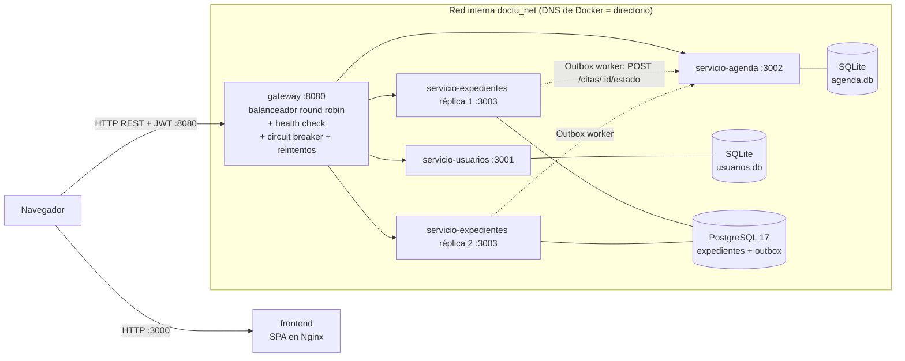
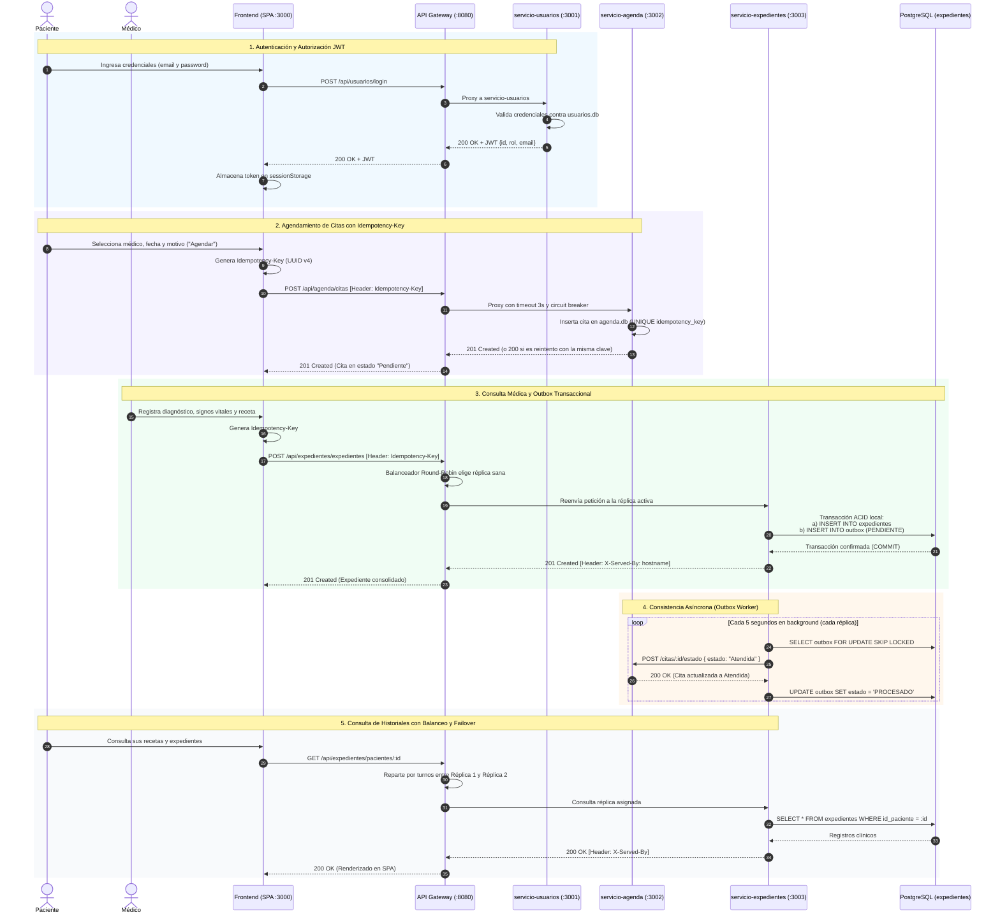

# DOCTU — Sistema Distribuido de Historiales Clínicos y Citas Médicas

**Rama `03-resiliencia-y-consistencia`** · versión final del prototipo.

DOCTU centraliza expedientes clínicos y citas médicas entre consultorios y hospitales. Es un sistema distribuido con tres microservicios de dominio, un API Gateway con balanceo de carga, réplicas, bases aisladas por servicio y mecanismos de resiliencia: Outbox, Idempotency-Key, Circuit Breaker, reintentos con backoff y health checks.

| Integrante | GitHub |
| :--- | :--- |
| Rodríguez Jaramillo Alejandro | [@Jaramilloooo29](https://github.com/Jaramilloooo29) |
| Cortés Bolaños Angel David | [@cortesangel](https://github.com/cortesangel) |
| Salgado Cruz Emiliano Roman | [@Emiliano24246](https://github.com/Emiliano24246) |
| Sanchez Mayen Tristan Qesen | [@Tristanqsm](https://github.com/Tristanqsm) |

PRD: [`docs/PRD.md`](https://github.com/Tristanqsm/Doctu_SD/blob/main/docs/PRD.md) (rama `main`).

---

## 1. Cómo levantarlo

**Requisitos:** Docker Desktop (o Docker Engine) con Docker Compose v2. No hace falta instalar Node.js.

```bash
git clone https://github.com/Tristanqsm/Doctu_SD.git
cd Doctu_SD
git checkout 03-resiliencia-y-consistencia
docker compose up --build -d
docker compose ps
```

`docker compose ps` debe mostrar **7 contenedores**. `postgres-expedientes` y las dos réplicas de expedientes aparecen como `healthy`:

```
doctu-frontend-1               Up
doctu-gateway-1                Up
doctu-postgres-expedientes-1   Up (healthy)
doctu-servicio-agenda-1        Up
doctu-servicio-expedientes-1   Up (healthy)
doctu-servicio-expedientes-2   Up (healthy)
doctu-servicio-usuarios-1      Up
```

| Qué | URL |
| :--- | :--- |
| Aplicación web (SPA) | http://localhost:3000 |
| API Gateway (única entrada a la API) | http://localhost:8080/api/... |
| Estado del gateway: circuit breakers y balanceadores | http://localhost:8080/health |

**Credenciales sembradas** (contraseña `password123` en todas):

| Rol | Correo |
| :--- | :--- |
| Médico | `doctor@doctu.com`, `elena@doctu.com` |
| Paciente | `paciente@doctu.com`, `maria@doctu.com`, `carlos@doctu.com` |

**Empezar desde cero** (borra los datos y vuelve a sembrarlos):

```bash
docker compose down -v
docker compose up --build -d
```

> Si traías levantada una versión anterior de esta rama (cuando el proyecto se llamaba `doctu_sd`), bájala primero con `docker compose -p doctu_sd down -v`. Si no, choca en los puertos 3000 y 8080.

---

## 2. Arquitectura

### 2.1 Diagrama de componentes y red



Solo se publican los puertos **3000** (frontend) y **8080** (gateway). Los servicios y las bases solo son alcanzables dentro de la red interna.

| Pieza | Dónde vive | Detalle |
| :--- | :--- | :--- |
| **API Gateway** | `gateway/` (contenedor `gateway`, puerto 8080) | Única entrada. Enruta `/api/usuarios`, `/api/agenda` y `/api/expedientes`. |
| **Directorio** | DNS interno de Docker Compose | `servicio-expedientes` resuelve a las IPs de **todas** sus réplicas. Docker da de alta y de baja la IP cuando un contenedor arranca o se detiene. |
| **Balanceador** | `gateway/resilience/loadBalancer.js` | Cada 5 s resuelve el DNS y hace `GET /health` a cada IP. Reparte por turnos entre las réplicas sanas. |
| **Réplicas** | `docker-compose.yml` → `deploy.replicas: 2` | El servicio replicado es **expedientes**, que concentra las consultas de historiales. |
| **Datos** | Una base por servicio (*Database per Service*) | `usuarios` y `agenda` usan SQLite en volúmenes propios. `expedientes` usa **PostgreSQL**, porque sus réplicas necesitan ver los mismos datos (con SQLite cada contenedor tendría su propio archivo). No hay llaves foráneas entre bases: los servicios se refieren a otras entidades solo por ID. |
| **Autenticación** | `usuarios` emite el JWT y cada servicio lo verifica | Sin sesiones en memoria, por eso cualquier réplica puede atender cualquier petición. |

---

### 2.2 Diagrama funcional: flujos de punta a punta

Este diagrama ilustra los flujos funcionales del sistema desde la interacción del usuario en la SPA hasta la persistencia y coordinación distribuida entre microservicios:



#### Descripción de los pasos funcionales:

| Flujo | Acción del usuario | Componentes involucrados | Mecanismo aplicado |
| :--- | :--- | :--- | :--- |
| **1. Autenticación** | Inicia sesión con su rol (`médico` o `paciente`). | Frontend &rarr; Gateway &rarr; `servicio-usuarios` &rarr; SQLite | Emisión de token JWT sin sesiones en memoria. |
| **2. Agendar Cita** | Paciente selecciona médico, fecha y motivo. | Frontend &rarr; Gateway &rarr; `servicio-agenda` &rarr; SQLite | Cabecera `Idempotency-Key` con restricción `UNIQUE` en base de datos. Si el cliente reintenta tras timeout, devuelve el registro existente sin duplicar. |
| **3. Consulta Médica** | Médico captura signos vitales, diagnóstico y receta. | Frontend &rarr; Gateway &rarr; `servicio-expedientes` &rarr; PostgreSQL | **Outbox Transaccional:** se inserta el expediente y el evento `PENDIENTE` en la misma transacción local ACID. Respuesta inmediata 201 con cabecera `X-Served-By`. |
| **4. Consistencia Outbox** | Automático en segundo plano. | Worker de expedientes &rarr; PostgreSQL &rarr; `servicio-agenda` &rarr; SQLite | **Consistencia Eventual:** Worker toma eventos con `SELECT FOR UPDATE SKIP LOCKED`, llama a agenda para marcar la cita como `Atendida` y actualiza el evento a `PROCESADO`. Si agenda está caída, reintenta hasta que vuelva a operar. |
| **5. Consulta de Historial** | Médico o paciente consulta expedientes clínicos. | Frontend &rarr; Gateway &rarr; Réplicas de expedientes &rarr; PostgreSQL | **Balanceo Round-Robin:** el Gateway consulta el DNS de Docker y realiza health checks activos (`GET /health`), repartiendo peticiones entre réplicas sanas con failover automático. |

---

## 3. Resiliencia y consistencia: qué hay y dónde

| Mecanismo | Dónde | Qué resuelve |
| :--- | :--- | :--- |
| **Balanceo + health check activo** | `gateway/resilience/loadBalancer.js` | Reparte la carga entre réplicas. Saca de la rotación la réplica que no responde `/health` en 1.5 s, aunque su contenedor siga vivo (colgado o enfermo). El DNS de Docker no ve ese caso. |
| **Failover y reintentos con backoff** | `gateway/server.js` | Si una réplica falla, el reintento va a **otra** réplica, con espera de 250 ms y luego 500 ms. Un POST solo se reintenta si trae `Idempotency-Key` o si la conexión TCP nunca se abrió, porque entonces el servicio no recibió la petición. |
| **Timeouts** | `gateway/resilience/httpClient.js` | 1 s para conectar y 3 s en total por petición. Así se distingue "no llegó" de "llegó y no contestó". |
| **Circuit Breaker** | `gateway/resilience/circuitBreaker.js` | CLOSED → OPEN tras 3 fallos seguidos, después HALF_OPEN a los 15 s. Mientras está abierto responde `503` en milisegundos con `degradado: true`. |
| **Transactional Outbox** | `expedientes/workers/outboxWorker.js` | Al crear un expediente, el evento para marcar la cita como `Atendida` se guarda en la tabla `outbox` **en la misma transacción**. Un worker lo reintenta cada 5 s hasta que agenda lo confirma: consistencia eventual. |
| **Outbox con réplicas** | `SELECT ... FOR UPDATE SKIP LOCKED` | Cada réplica corre su worker. El candado hace que cada evento lo tome una sola réplica. |
| **Idempotency-Key** | `agenda` (citas) y `expedientes` | La llave se guarda con restricción `UNIQUE`. Un reintento con la misma llave regresa el registro original y no crea un duplicado. En expedientes se usa `INSERT ... ON CONFLICT DO NOTHING`. |
| **Apagado ordenado** | `expedientes/server.js` | Ante `SIGTERM`, la réplica deja de aceptar conexiones, termina las peticiones en curso y cierra la base. `docker stop` tarda menos de 1 s. |

---

## 4. Probar los flujos

Desde la web (http://localhost:3000):

1. **Login JWT:** entra como `doctor@doctu.com`.
2. **Agendar cita:** entra como paciente y agenda una cita (el frontend manda `Idempotency-Key`).
3. **Expediente → cita:** como médico, registra un expediente sobre una cita. La cita pasa a `Atendida`.

Por API (bash; en Windows usa **Git Bash**):

```bash
G=http://localhost:8080/api
TOKEN=$(curl -s -X POST $G/usuarios/login -H 'Content-Type: application/json' \
  -d '{"email":"doctor@doctu.com","password":"password123","rol":"medico"}' \
  | sed -E 's/.*"token":"([^"]+)".*/\1/')

# Idempotencia: el mismo POST dos veces -> 201 la primera, 200 "recuperado" la segunda
for i in 1 2; do
  curl -s -X POST $G/expedientes/expedientes -H "Authorization: Bearer $TOKEN" \
    -H 'Content-Type: application/json' -H 'Idempotency-Key: demo-1' \
    -d '{"id_paciente":4,"motivo_consulta":"Demo","diagnostico":"Dx","tratamiento_receta":"Tx"}'
  echo
done

# Qué réplica atendió cada consulta (cabecera X-Served-By)
for i in 1 2 3 4; do
  curl -s -o /dev/null -w '%{http_code} %header{x-served-by}\n' \
    $G/expedientes/expedientes -H "Authorization: Bearer $TOKEN"
done
```

---

## 5. Pruebas de falla

### 5.1 Caída de réplicas (balanceo)

```bash
./scripts/demo-balanceo.sh            # reparto + 4 escenarios (~3 min)
./scripts/demo-balanceo.sh stop       # o solo uno: reparto | stop | kill | enferma | colgada
```

El script hace una consulta cada medio segundo por el gateway, provoca la falla en la consulta 5, la repara en la 25 y cuenta los errores:

| Escenario | Cómo se provoca | Quién lo detecta | Resultado esperado |
| :--- | :--- | :--- | :--- |
| `stop` | `docker stop doctu-servicio-expedientes-1` | Falla de conexión (pasivo) y luego DNS (baja) | 0 errores |
| `kill` | `docker kill ...` (corte abrupto) | Igual que `stop` | 0 errores |
| `enferma` | `docker exec ... touch /tmp/doctu-no-sano` → `/health` responde 503 | Health check activo | 0 errores |
| `colgada` | `docker pause ...` (proceso congelado) | Timeout + health check activo | 0 errores (una consulta tarda ~4 s) |

Para seguir los eventos del balanceador en vivo: `docker compose logs -f gateway`.

> En Git Bash, `docker exec ... /tmp/...` necesita `MSYS_NO_PATHCONV=1` para que `/tmp` no se convierta en una ruta de Windows. El script ya lo define.

### 5.2 Caída de agenda al guardar un expediente (Outbox)

```bash
docker compose stop servicio-agenda
```

1. Como médico, registra un expediente sobre una cita, desde la web o con `curl` usando `"id_cita": 2`. La respuesta es **201**: el expediente se guarda y aparece `advertencia_agenda` porque la cita aún no se actualiza.
2. Revisa el outbox: el evento está `PENDIENTE` y sus intentos suben cada 5 s.
   ```bash
   curl -s $G/expedientes/expedientes/outbox -H "Authorization: Bearer $TOKEN"
   ```
3. Levanta agenda y espera unos segundos:
   ```bash
   docker compose start servicio-agenda
   ```
   El evento pasa a `PROCESADO` (con `procesado_por` = la réplica que lo entregó) y la cita queda `Atendida`.

### 5.3 Circuit Breaker

```bash
docker compose stop servicio-agenda
for i in 1 2 3 4; do
  curl -s -o /dev/null -w '%{http_code} circuito=%header{x-circuit-state}\n' \
    $G/agenda/citas -H "Authorization: Bearer $TOKEN"
done
curl -s http://localhost:8080/health      # servicio-agenda: state OPEN
docker compose start servicio-agenda      # ~15 s después: HALF_OPEN -> CLOSED
```

---

## 6. Estructura

```
gateway/       API Gateway: proxy, balanceador, circuit breaker, reintentos
usuarios/      Login/registro (JWT), perfiles, catálogo de médicos — SQLite
agenda/        Citas médicas con Idempotency-Key — SQLite
expedientes/   Expedientes clínicos + outbox worker — PostgreSQL, 2 réplicas
frontend/      SPA (HTML/CSS/JS) servida por Nginx
scripts/       demo-balanceo.sh
```

| Rama | Contenido |
| :--- | :--- |
| `main` | README general y `docs/PRD.md` |
| `01-monolito` | Monolito MVC (Express + EJS + SQLite) |
| `02-separacion` | 3 microservicios, gateway, JWT, bases aisladas y SPA |
| `03-resiliencia-y-consistencia` | Esta rama: réplicas, balanceo, PostgreSQL en expedientes, outbox, idempotencia y circuit breaker |

---

## 7. Alcance y pendientes

- **HU-02 (consentimientos)** y **HU-06 (antecedentes del paciente):** no implementadas en esta versión.
- Los eventos viajan por **outbox + HTTP**, no por un broker dedicado (RabbitMQ o Kafka).
- El outbox guarda el JWT del médico para llamar a agenda. Si agenda estuviera caída más de 24 h (la vigencia del token), el evento terminaría `FALLIDO`. Lo correcto sería una credencial de servicio a servicio.
- Solo **expedientes** está replicado. `usuarios` y `agenda` siguen con una instancia y SQLite. El gateway también es una sola instancia.
- Sin HTTPS ni observabilidad centralizada (métricas y trazas); el estado se consulta en `/health` y en los logs.
