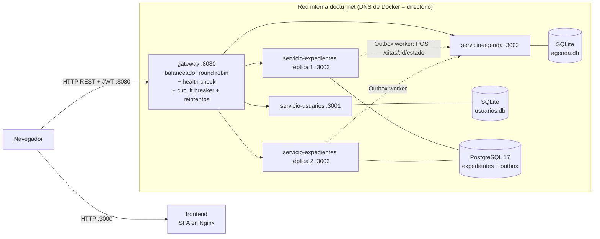

# DOCTU — Sistema Distribuido de Historiales Clínicos y Citas Médicas

**Rama `03-resiliencia-y-consistencia`** · versión final del prototipo.

DOCTU centraliza expedientes clínicos y citas médicas entre consultorios y hospitales. Es un sistema distribuido con tres microservicios de dominio, un API Gateway con balanceo de carga, réplicas, bases aisladas por servicio y mecanismos de resiliencia: Outbox, Idempotency-Key, Circuit Breaker, reintentos con backoff y health checks.

| Integrante | GitHub |
| :--- | :--- |
| Rodríguez Jaramillo Alejandro | [@Jaramilloooo29](https://github.com/Jaramilloooo29) |
| Cortés Bolaños Angel David | [@cortesangel](https://github.com/cortesangel) |
| Salgado Cruz Emiliano Roman | [@Emiliano24246](https://github.com/Emiliano24246) |
| Sanchez Mayen Tristan Qesen | [@Tristanqsm](https://github.com/Tristanqsm) |

PRD: [`docs/PRD.md`](https://github.com/Tristanqsm/Doctu_SD/blob/main/docs/PRD.md) (rama `main`).

---

## 1. Cómo levantarlo

**Requisitos:** Docker Desktop (o Docker Engine) con Docker Compose v2. No hace falta instalar Node.js.

```bash
git clone https://github.com/Tristanqsm/Doctu_SD.git
cd Doctu_SD
git checkout 03-resiliencia-y-consistencia
docker compose up --build -d
docker compose ps
```

`docker compose ps` debe mostrar **7 contenedores**. `postgres-expedientes` y las dos réplicas de expedientes aparecen como `healthy`:

```
doctu-frontend-1               Up
doctu-gateway-1                Up
doctu-postgres-expedientes-1   Up (healthy)
doctu-servicio-agenda-1        Up
doctu-servicio-expedientes-1   Up (healthy)
doctu-servicio-expedientes-2   Up (healthy)
doctu-servicio-usuarios-1      Up
```

| Qué | URL |
| :--- | :--- |
| Aplicación web (SPA) | http://localhost:3000 |
| API Gateway (única entrada a la API) | http://localhost:8080/api/... |
| Estado del gateway: circuit breakers y balanceadores | http://localhost:8080/health |

**Credenciales sembradas** (contraseña `password123` en todas):

| Rol | Correo |
| :--- | :--- |
| Médico | `doctor@doctu.com`, `elena@doctu.com` |
| Paciente | `paciente@doctu.com`, `maria@doctu.com`, `carlos@doctu.com` |

**Empezar desde cero** (borra los datos y vuelve a sembrarlos):

```bash
docker compose down -v
docker compose up --build -d
```

> Si traías levantada una versión anterior de esta rama (cuando el proyecto se llamaba `doctu_sd`), bájala primero con `docker compose -p doctu_sd down -v`. Si no, choca en los puertos 3000 y 8080.

---

## 2. Arquitectura



Solo se publican los puertos **3000** (frontend) y **8080** (gateway). Los servicios y las bases solo son alcanzables dentro de la red interna.

| Pieza | Dónde vive | Detalle |
| :--- | :--- | :--- |
| **API Gateway** | `gateway/` (contenedor `gateway`, puerto 8080) | Única entrada. Enruta `/api/usuarios`, `/api/agenda` y `/api/expedientes`. |
| **Directorio** | DNS interno de Docker Compose | `servicio-expedientes` resuelve a las IPs de **todas** sus réplicas. Docker da de alta y de baja la IP cuando un contenedor arranca o se detiene. |
| **Balanceador** | `gateway/resilience/loadBalancer.js` | Cada 5 s resuelve el DNS y hace `GET /health` a cada IP. Reparte por turnos entre las réplicas sanas. |
| **Réplicas** | `docker-compose.yml` → `deploy.replicas: 2` | El servicio replicado es **expedientes**, que concentra las consultas de historiales. |
| **Datos** | Una base por servicio (*Database per Service*) | `usuarios` y `agenda` usan SQLite en volúmenes propios. `expedientes` usa **PostgreSQL**, porque sus réplicas necesitan ver los mismos datos (con SQLite cada contenedor tendría su propio archivo). No hay llaves foráneas entre bases: los servicios se refieren a otras entidades solo por ID. |
| **Autenticación** | `usuarios` emite el JWT y cada servicio lo verifica | Sin sesiones en memoria, por eso cualquier réplica puede atender cualquier petición. |

---

## 3. Resiliencia y consistencia: qué hay y dónde

| Mecanismo | Dónde | Qué resuelve |
| :--- | :--- | :--- |
| **Balanceo + health check activo** | `gateway/resilience/loadBalancer.js` | Reparte la carga entre réplicas. Saca de la rotación la réplica que no responde `/health` en 1.5 s, aunque su contenedor siga vivo (colgado o enfermo). El DNS de Docker no ve ese caso. |
| **Failover y reintentos con backoff** | `gateway/server.js` | Si una réplica falla, el reintento va a **otra** réplica, con espera de 250 ms y luego 500 ms. Un POST solo se reintenta si trae `Idempotency-Key` o si la conexión TCP nunca se abrió, porque entonces el servicio no recibió la petición. |
| **Timeouts** | `gateway/resilience/httpClient.js` | 1 s para conectar y 3 s en total por petición. Así se distingue "no llegó" de "llegó y no contestó". |
| **Circuit Breaker** | `gateway/resilience/circuitBreaker.js` | CLOSED → OPEN tras 3 fallos seguidos, después HALF_OPEN a los 15 s. Mientras está abierto responde `503` en milisegundos con `degradado: true`. |
| **Transactional Outbox** | `expedientes/workers/outboxWorker.js` | Al crear un expediente, el evento para marcar la cita como `Atendida` se guarda en la tabla `outbox` **en la misma transacción**. Un worker lo reintenta cada 5 s hasta que agenda lo confirma: consistencia eventual. |
| **Outbox con réplicas** | `SELECT ... FOR UPDATE SKIP LOCKED` | Cada réplica corre su worker. El candado hace que cada evento lo tome una sola réplica. |
| **Idempotency-Key** | `agenda` (citas) y `expedientes` | La llave se guarda con restricción `UNIQUE`. Un reintento con la misma llave regresa el registro original y no crea un duplicado. En expedientes se usa `INSERT ... ON CONFLICT DO NOTHING`. |
| **Apagado ordenado** | `expedientes/server.js` | Ante `SIGTERM`, la réplica deja de aceptar conexiones, termina las peticiones en curso y cierra la base. `docker stop` tarda menos de 1 s. |

---


## Frontend SPA (`frontend/`)

- **`frontend/index.html`**: Contenedor raíz de la SPA (`#navbar-root`, `#app`, `#footer`) y carga de `/js/app.js` y `/css/style.css`.
- **`frontend/js/app.js`**: Enrutamiento por hash (`#/`, `#/login`, `#/registro`, `#/dashboard-medico`, `#/portal-paciente`, `#/citas/nueva`, `#/expedientes/nuevo`, `#/expedientes/:id`, `#/expedientes/paciente/:id`), cliente HTTP hacia `http://localhost:8080/api` con gestión de JWT en `localStorage`, resolución de nombres/perfiles vía `/usuarios/batch` y utilidades de UI/notificaciones.
- **`frontend/js/ui.js` y `frontend/js/api.js`**: Módulos auxiliares de interfaz y comunicación.
- **`frontend/css/style.css` y `frontend/assets/`**: Estilos visuales y recursos gráficos de la aplicación.

---

## Ejecución rápida con Docker Compose

```bash
docker compose up --build -d
docker compose ps
```

- **Aplicación web:** `http://localhost:3000`
- **Healthcheck del Gateway:** `http://localhost:8080/health`

### Credenciales de prueba sembradas
- **Médico:** `doctor@doctu.com` / `password123` (rol `medico`) o `elena@doctu.com` / `password123`
- **Paciente:** `paciente@doctu.com` / `password123` (rol `paciente`), `maria@doctu.com` / `password123` o `carlos@doctu.com` / `password123`